<div align="center">


# VayuKavach

### India's year-round environmental health shield

**Sameer tells you the AQI. VayuKavach tells you whether you can trust it, and what to do about it,**
**every season, in every district.**

[](https://github.com/tanaygit0530/Vayukavach/actions/workflows/ci.yml)


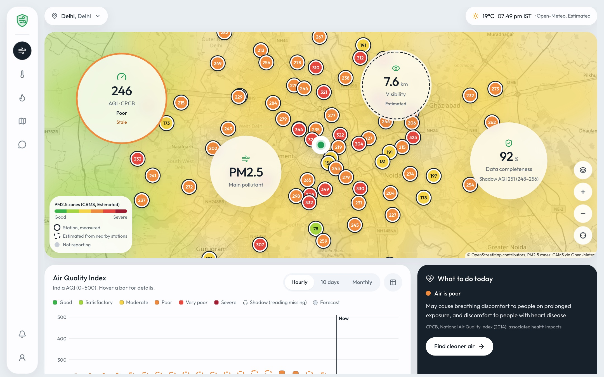

<sub>Air tab, Delhi, live data: 82 CPCB stations on the map, official AQI 246 (Poor), 92% of expected readings received, shadow AQI 251 (248–256).</sub>

</div>

---

## The problem, in four numbers

| | |
|:--|:--|
| **376** | Delhi's average AQI on Diwali, 8 Nov 2026: the highest festival-day reading since 2021 |
| **10 of 59** | Delhi monitoring stations not reporting the next morning |
| **125** | station-hours missing from CPCB's record, released later by DPCC. **Every one was above 1,000 µg/m³** |
| **247 billion** | labour hours India lost to heat in 2024; 92% of the workforce is informal |

Today these data gaps are found only by journalists, by hand, after the fact. And heat alerts are
temperature-first, while humid heat is what harms outdoor workers.

> **In one line:** Indians get an environmental number every day, but no way to know if it is complete,
> and no clear instruction on what to do about it.

---

## What VayuKavach does

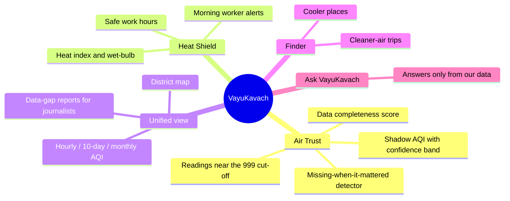

| Module | What you get | Status |
|---|---|:-:|
| **Air Trust** | Official AQI **next to** a shadow AQI that fills missing hours, the share of readings that actually arrived, and a flag when gaps cluster in the most polluted hours | ✅ |
| **Air tab** | Pollution map, station pins (measured / estimated / silent), hourly · 10-day · monthly AQI, pollutants, wind, CPCB health advice | ✅ |
| **Temperature tab** | Feels-like with a reason, 7 AM–7 PM trend, 10-day forecast, sun arc, UV gauge, CSV export | ✅ |
| **Heat Shield** | Heat index + wet-bulb, Normal → Extreme colour-by-danger page, safe work windows, NDMA tips | ✅ |
| **Finder** | Cleaner or cooler places with routes and precautions | ⏳ |
| **Ask VayuKavach** | A chatbot that answers only from VayuKavach's data, with sources | ⏳ |
| **Alerts** | Telegram messages in Hindi, Marathi and English | ⏳ |

---

## See it

<table>
<tr>
<td width="62%">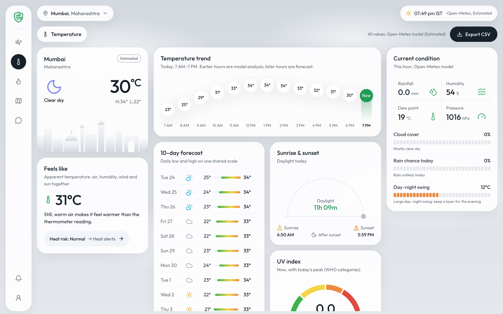</td>
<td width="38%">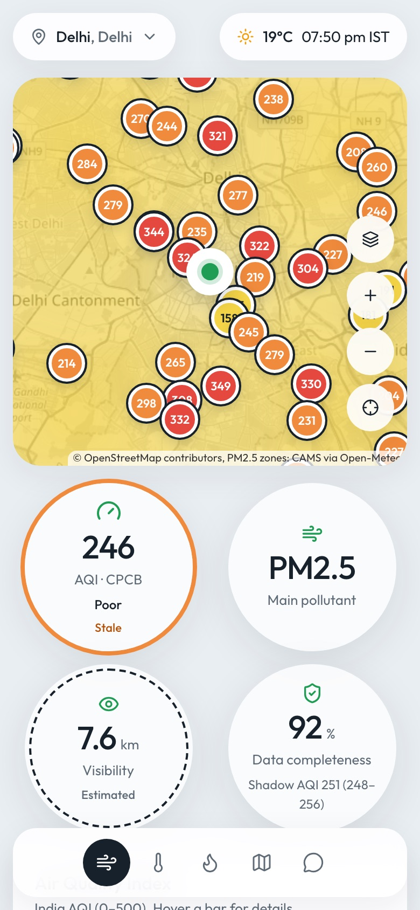</td>
</tr>
<tr>
<td><sub><b>Temperature tab</b> (Mumbai): moon after sunset, "Now" bubble, 10-day ranges on one scale, UV and condition cards.</sub></td>
<td><sub><b>Phone</b>: the icon rail becomes a bottom bar; bubbles move under the map.</sub></td>
</tr>
<tr>
<td colspan="2">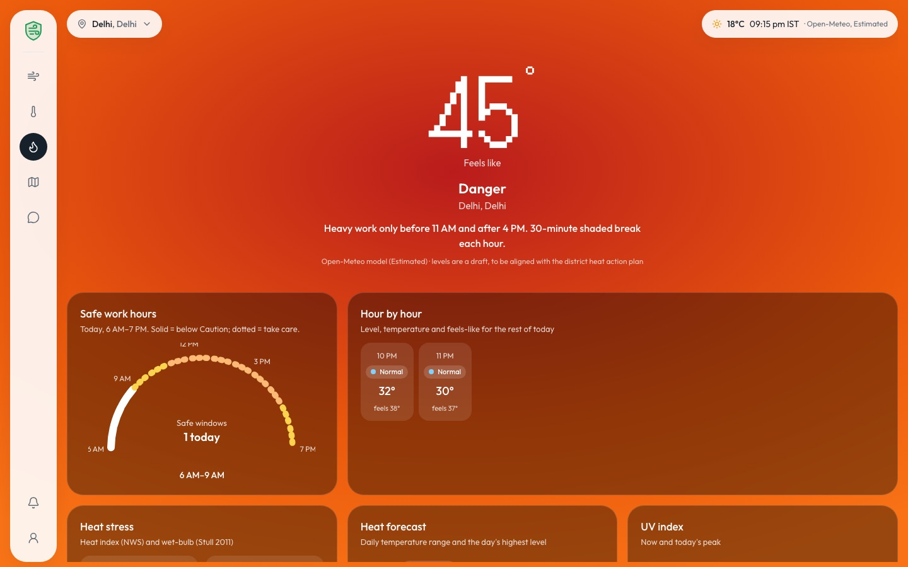</td>
</tr>
<tr>
<td colspan="2"><sub><b>Heat tab</b>: the whole page turns red at Danger. Big dot-matrix feels-like, the work-rest instruction, and a day arc where solid = safe hours and dotted = take care. (Danger shown with a test response; November data is Normal.)</sub></td>
</tr>
<tr>
<td>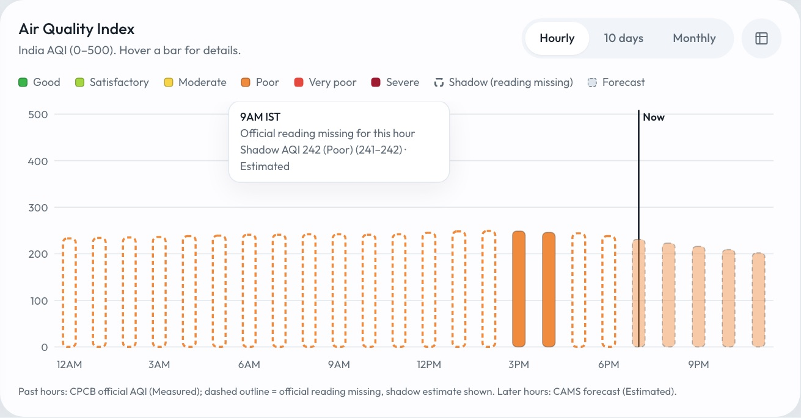</td>
<td>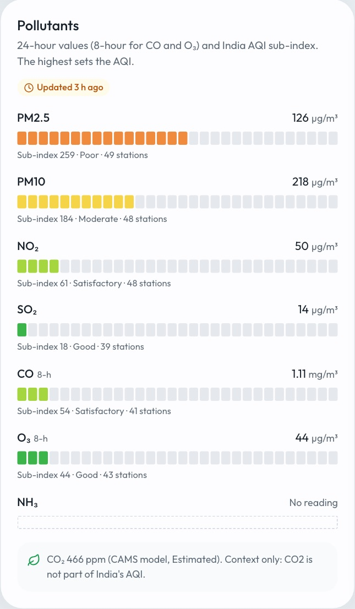</td>
</tr>
<tr>
<td><sub><b>Hourly AQI</b>: solid = CPCB official, dashed outline = official reading missing (shadow estimate in the tooltip), faded = forecast.</sub></td>
<td><sub><b>Pollutants</b>: 24-hour values and India AQI sub-index; CO₂ as context only.</sub></td>
</tr>
</table>

---

## How it works

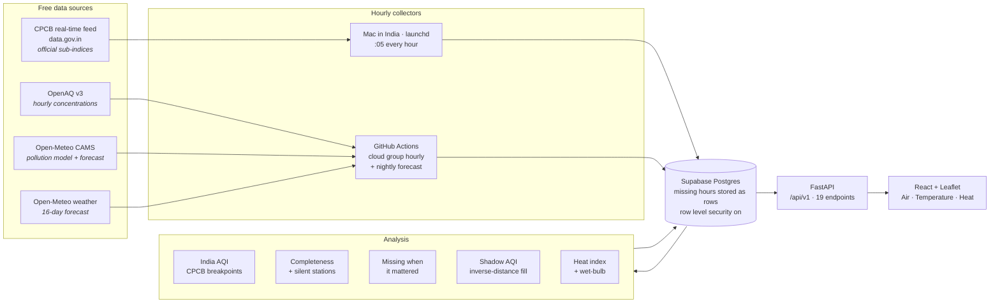

**Why CPCB runs on a Mac:** data.gov.in refuses connections from GitHub's US servers (`Connection refused`,
tested twice), but answers from India in about a second. So a small launchd job on a Mac in India
collects CPCB every hour, and GitHub collects everything else.

### One hour in the pipeline

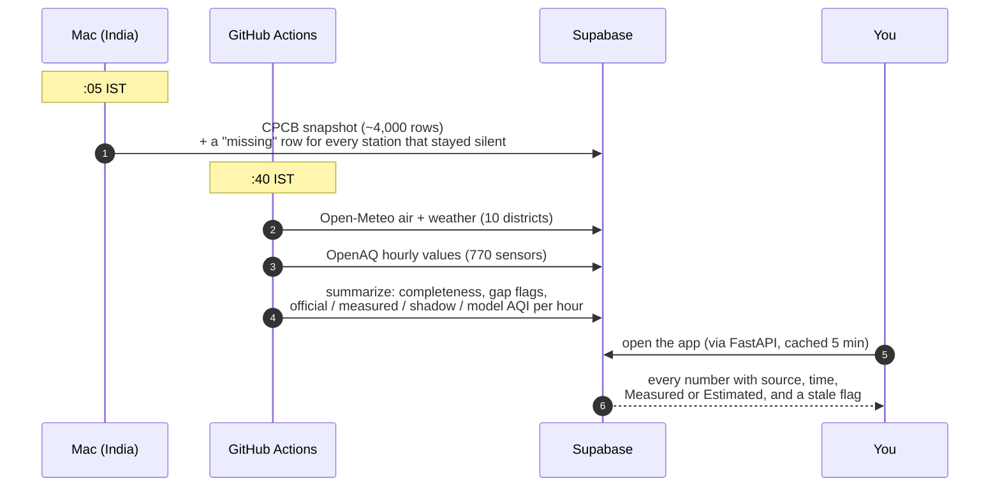

---

## The shadow AQI, explained

When a station goes silent, the official AQI is computed from the stations that are left.
If the silent ones were the most polluted, the official number looks cleaner than the air.

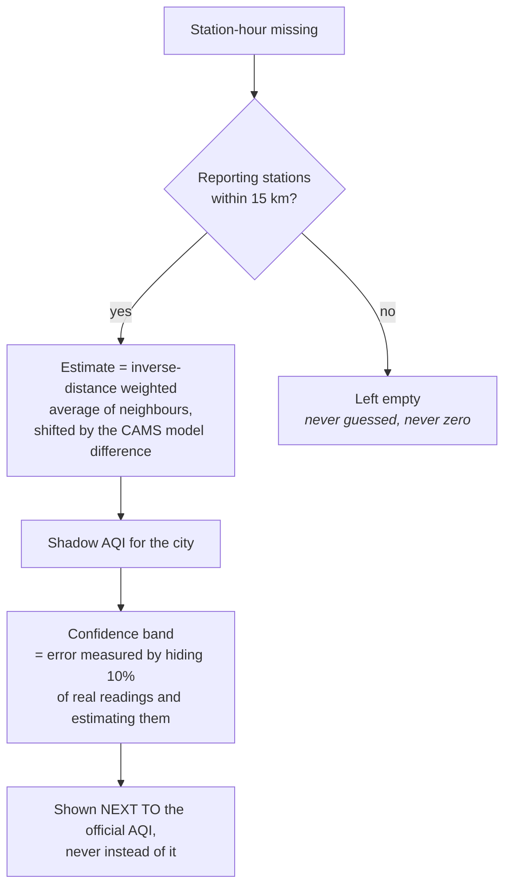

| Signal | How it's computed |
|---|---|
| **Data completeness** | received hours ÷ expected hours, per station, pollutant and day |
| **Silent stations** | 3+ consecutive hours with nothing received |
| **City-wide silence** | hours when 25%+ of a city's stations were silent together |
| **Missing when it mattered** | missing rate in the 6 most polluted hours − missing rate in the 6 cleanest; flag at **20 points** |
| **Near the 999 cut-off** | PM readings ≥ 950 µg/m³; CPCB drops ≥ 999 from the AQI |

---

## Checked against CPCB's own numbers

We compute India's AQI from raw station concentrations and compare it with the sub-indices CPCB
publishes for the **same stations and hours** (40 Delhi station-hours,
[full report](docs/validation/aqi_vs_cpcb.md)).

| Pollutant | Mean difference (AQI points) | Within ±10 |
|---|:-:|:-:|
| SO₂ | **0.2** | 100% |
| O₃ | **1.1** | 100% |
| NO₂ | **1.7** | 98% |
| PM10 | **3.6** | 92% |
| CO | **5.3** | 90% |
| PM2.5 | **7.2** | 92% |
| **Station AQI** | **7.4** | **90%** |

City level, Delhi: **CPCB 249 · our measured AQI 250 · shadow AQI 249.**

<details>
<summary><b>What the comparison taught us</b> (we started 31 points off)</summary>

| Finding | Effect | Fix |
|---|---|---|
| OpenAQ labels CPCB gases as **ppb**, but the numbers are **µg/m³** (mg/m³ for CO) | NO₂ 1.92× and SO₂ 2.63× too high, exactly the molecular-weight factor | Read as native units; data migration corrected stored rows |
| CPCB's `last_update` is the **end** of the averaging hour | Every window one hour late | Store the reading under the hour it closes |
| CPCB's running CO/O₃ index uses the **last 8 hours** | CO off by a constant 1.6× | Running 8-h mean for "now", daily max for days |
| CPCB's 24-h index **averages hourly sub-indices** | PM2.5 26.7 points off; the PM2.5 scale bends at 120 µg/m³ | Same method as CPCB, so official vs shadow differences come from missing data, not from maths |

</details>

---

## 10-day AQI forecast, tested on a year of history

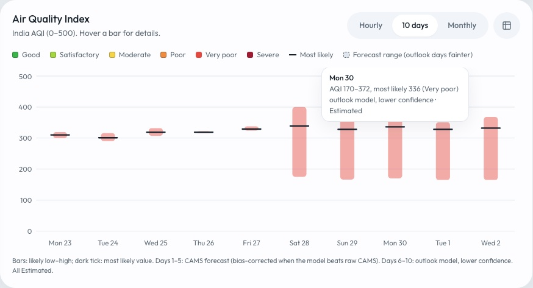

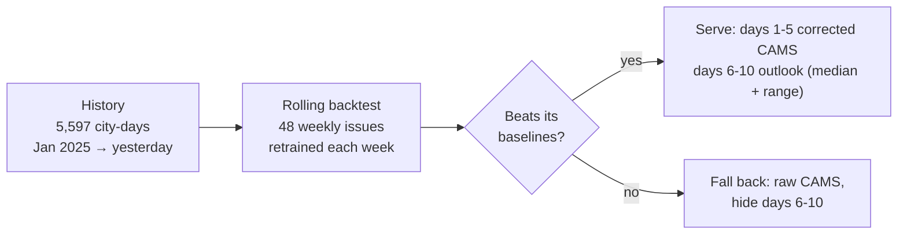

| Mean error (AQI points) | **Ours** | Raw CAMS | Tomorrow = today | Month average |
|---|:-:|:-:|:-:|:-:|
| Days 1–5 (CAMS corrected with yesterday's station data) | **19.3** | 53.1 | 24.7 | – |
| Days 6–10 (quantile outlook) | **21.1** | – | 27.9 | 24.6 |

The correction cuts raw CAMS's error by 64% and gets the CPCB category right 70–74% of the time
(raw CAMS: 40–47%). Retrained nightly; a model is only served if it beats its baselines.
Details, limits and the per-day table: [model card](docs/models/model-card.md) ·
[backtest](docs/models/backtest.md).

---

## Honesty rules, built in

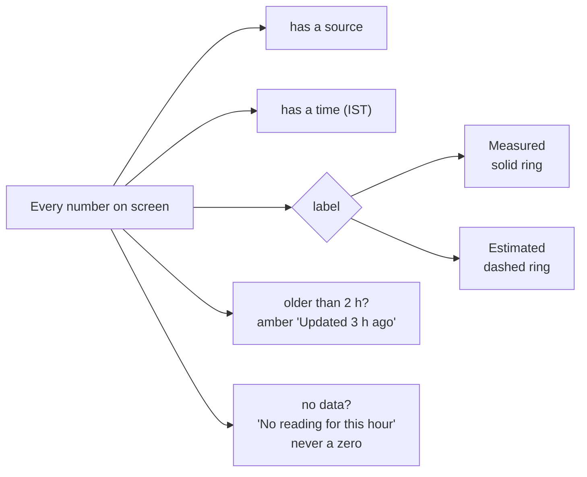

- India's **National AQI** (0–500, CPCB breakpoints), never US or EU AQI.
- Missing data is **stored as data** (a row with a reason), never skipped.
- Neutral wording: **data completeness and reliability**, never blame.
- Districts without a station (Shimla) show a **model estimate, clearly labelled**.
- CPCB category colours are mandated but hard to tell apart for colour-blind readers, so the
  **category word and number always sit next to the colour**, and charts have a table view.

---

## Tech stack

| Layer | Tools |
|---|---|
| Data collection | Python 3.11, httpx + tenacity (retries, backoff, rate limits), GitHub Actions cron, macOS launchd |
| Database | PostgreSQL on Supabase (free tier), SQLAlchemy 2 + Alembic, row level security |
| Analysis & ML | pandas, NumPy, LightGBM (quantile + bias-correction models), scikit-learn: India AQI, completeness, gap bias, shadow AQI, heat index (NWS), wet-bulb (Stull 2011) |
| API | FastAPI, Pydantic models, TTL cache, per-IP rate limit, OpenAPI docs |
| Frontend | React 19, Vite, TypeScript, Tailwind, React Router, TanStack Query, Leaflet + OpenStreetMap, hand-made SVG charts |
| Quality | pytest (213 tests), Vitest (32) + Testing Library, Playwright screenshots, ruff, ESLint, CI on every push |

---

## Project structure

```text
VayuKavach/
├── backend/            FastAPI app, models, Alembic migrations, analysis/ (AQI, shadow, heat…), tests
├── jobs/               Hourly collectors (CPCB, OpenAQ, Open-Meteo), run.py, launchd installer, tests
├── frontend/           React app: shell, Air tab, Temperature tab, shared UI, tests
├── docs/               Spec, build plan, progress log, validation report, design references
└── .github/workflows/  CI (lint + tests) and hourly collection
```

---

## Run it locally

```bash
cp .env.example .env              # add DATA_GOV_IN_API_KEY and OPENAQ_API_KEY
docker compose up -d db           # Postgres on localhost:5433

cd backend && uv sync && uv run alembic upgrade head
uv run uvicorn app.main:app --reload             # API → http://localhost:8000/docs

cd ../jobs && uv sync && uv run python run.py hourly   # collect once

cd ../frontend && npm install && npm run dev     # app → http://localhost:5180
```

Developer details (collectors, storage, hosting, API notes): [docs/README.md](docs/README.md)

---

## Roadmap

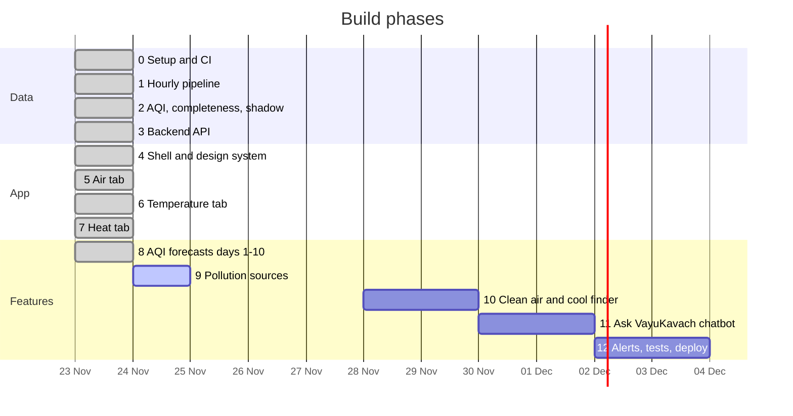

Progress log with checks for every phase: [docs/PROGRESS.md](docs/PROGRESS.md)

---

## Data and credits

| Source | Used for | Licence / terms |
|---|---|---|
| [CPCB real-time AQI](https://data.gov.in/resource/real-time-air-quality-index-various-locations) via data.gov.in | Official station sub-indices | Government Open Data Licence – India |
| [OpenAQ](https://openaq.org) | Hourly station concentrations | OpenAQ terms |
| [Open-Meteo](https://open-meteo.com) + [CAMS](https://atmosphere.copernicus.eu) | Pollution model, weather forecasts | CC BY 4.0 |
| [OpenStreetMap](https://www.openstreetmap.org/copyright) | Map tiles | © OpenStreetMap contributors (ODbL) |

<div align="center">
<sub>VayuKavach describes data completeness and reliability. It does not accuse anyone.</sub>
</div>
