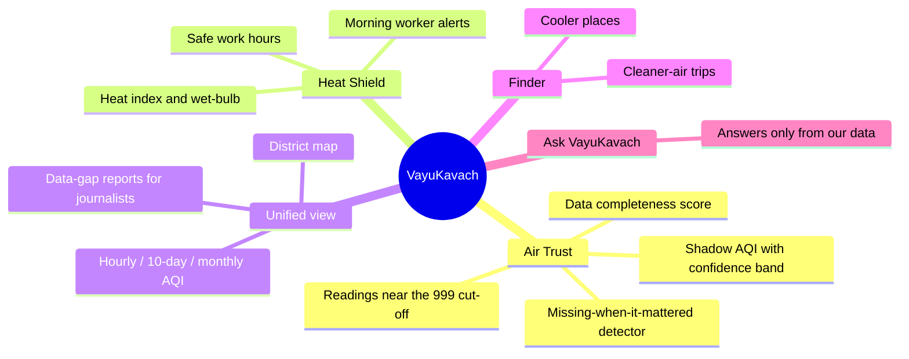
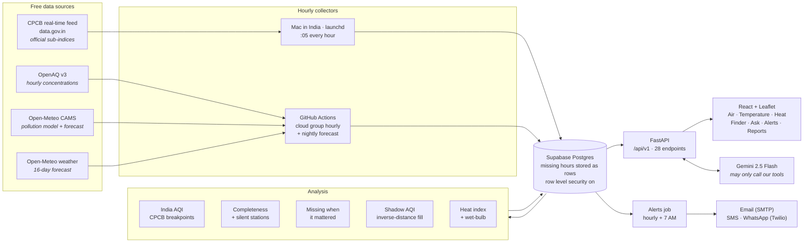
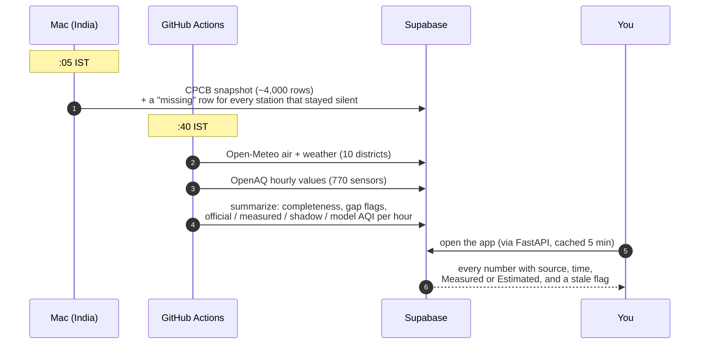
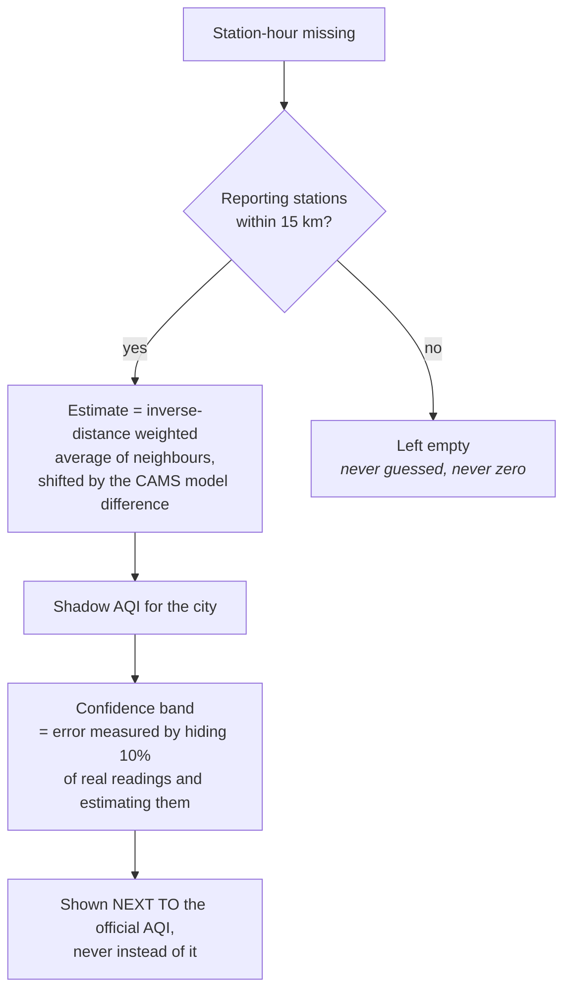
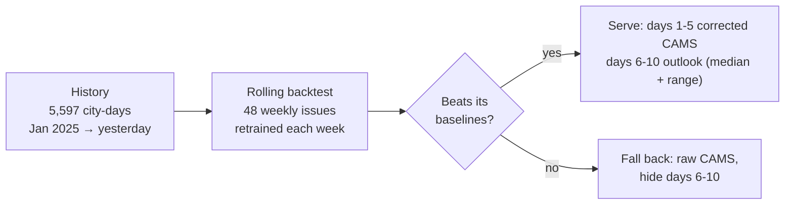
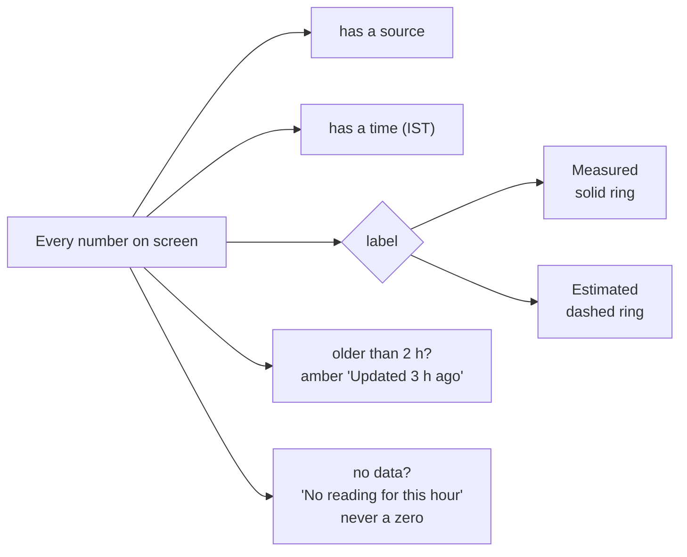

<div align="center">


# VayuKavach

### India's year-round environmental health shield

**Sameer tells you the AQI. VayuKavach tells you whether you can trust it, and what to do about it,**
**every season, in every district.**

**[Open the live app →](https://vayukavach-liart.vercel.app)** · [API docs](https://vayukavach-api.onrender.com/docs)
<sub>(free hosting: the first visit after a quiet hour can take about a minute to wake the API)</sub>

[](https://github.com/tanaygit0530/Vayukavach/actions/workflows/ci.yml)


</div>

---

## The problem

Every day Indians get one air-quality number, with no way to know whether it is complete. On
Diwali 2026, Delhi's monitoring stations went quiet exactly when the air was worst. And heat
alerts look at temperature alone, while humid heat is what harms outdoor workers.

**VayuKavach shows the official AQI, how complete the data behind it is, an estimate for the
missing hours, and clear advice on what to do: for air and heat, every season.**

---

## What it does



- **Air:** pollution map with station pins, official AQI next to a shadow AQI, data completeness,
  hourly · 10-day · monthly charts, pollutants, wind, pollution sources and CPCB health advice.
- **Temperature and Heat:** feels-like, heat index and wet-bulb, danger levels, safe work hours.
- **Finder:** cleaner-air and cooler places for a day trip or a vacation, with routes.
- **Ask VayuKavach:** a chatbot (Gemini) that answers only from VayuKavach's data, with sources,
  in English, Hindi and Marathi.
- **Alerts:** a 7 AM summary and instant alerts by WhatsApp or email.
- **Data reports:** completeness, silent stations and flagged hours per city and day, as CSV.

---

## How it works



### One hour in the pipeline



---

## The shadow AQI

When a station goes silent, the official AQI is computed from the stations that are left. If the
silent ones were the most polluted, the official number looks cleaner than the air.



---

## 10-day AQI forecast



---

## Honesty rules, built in



---

## Tech stack

| Layer | Tools |
|---|---|
| Data and jobs | Python 3.11, httpx, GitHub Actions, macOS launchd |
| Database | PostgreSQL on Supabase, SQLAlchemy 2 + Alembic |
| Analysis and ML | pandas, NumPy, LightGBM, scikit-learn |
| API | FastAPI |
| AI and alerts | Gemini 2.5 Flash (function calling), Twilio (WhatsApp, SMS), SMTP (email) |
| Frontend | React 19, Vite, TypeScript, Tailwind, TanStack Query, Leaflet + OpenStreetMap |
| Hosting | Vercel (frontend), Render (API), Supabase (database) |

---

## Run it locally

```bash
cp .env.example .env              # add your API keys
docker compose up -d db           # Postgres on localhost:5433

cd backend && uv sync && uv run alembic upgrade head
uv run uvicorn app.main:app --reload             # API → http://localhost:8000/docs

cd ../frontend && npm install && npm run dev     # app → http://localhost:5180
```

---

## Data and credits

| Source | Used for | Licence / terms |
|---|---|---|
| [CPCB real-time AQI](https://data.gov.in/resource/real-time-air-quality-index-various-locations) via data.gov.in | Official station sub-indices | Government Open Data Licence – India |
| [OpenAQ](https://openaq.org) | Hourly station concentrations | OpenAQ terms |
| [Open-Meteo](https://open-meteo.com) + [CAMS](https://atmosphere.copernicus.eu) | Pollution model, weather forecasts | CC BY 4.0 |
| [OpenStreetMap](https://www.openstreetmap.org/copyright) | Map tiles | © OpenStreetMap contributors (ODbL) |

<div align="center">
<sub>VayuKavach describes data completeness and reliability. It does not accuse anyone.</sub>
</div>
